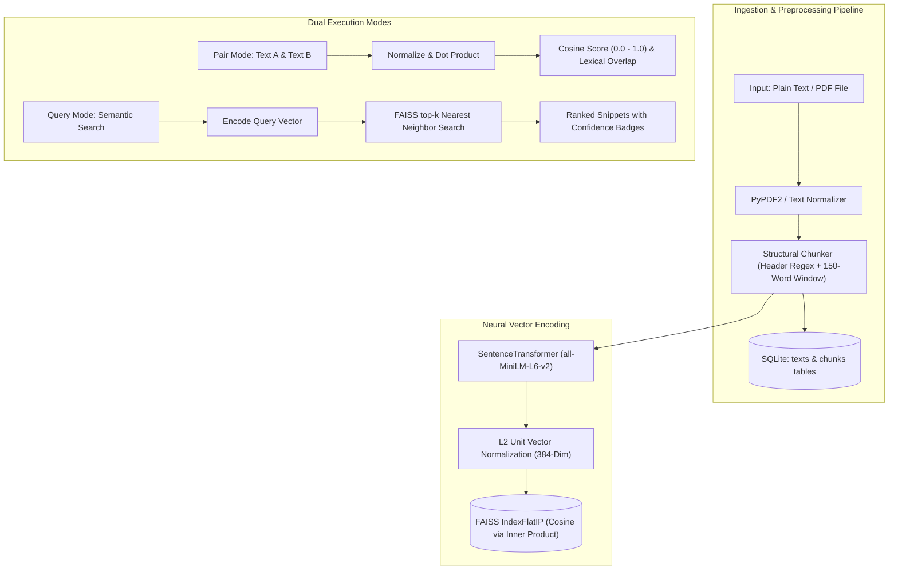

# Semantic Text Similarity & FAISS Retrieval Studio

> **Project #43** · Advanced Neural Text Similarity Analysis & Structural Vector Retrieval System.  
> Built with **Sentence Transformers (`all-MiniLM-L6-v2`)**, **FAISS (`IndexFlatIP`)**, **SQLite**, and **Flask**.

📖 **Deep-Dive Technical Reference & AI Context**: For an exhaustive, misconception-free architectural breakdown, mathematical proofs, and dataflow specifications, see [PROJECT_EXPLAINER.md](file:///c:/NLP_Project/PROJECT_EXPLAINER.md).

---

## 📌 Architecture Overview



---

## 🚀 Key Features

1. **Dual Similarity Evaluation Modes**:
   - **Pair Comparison Mode**: Computes direct cosine similarity between two texts with instant qualitative tiers (*Extremely High*, *High*, *Moderate*, *Low*, *Unrelated*), interactive animated circular gauges, and shared lexical token extraction.
   - **Corpus Query Search**: Encodes natural language queries and executes sub-millisecond vector similarity search against all structurally indexed document chunks.
2. **Structural Chunker**:
   - Detects markdown headers (`#`, `##`), numbered sections (`Section 1:`, `1.1`), and uppercase titles.
   - Automatically applies a 150-word sliding window with 30-word overlap for oversized sections, preserving semantic coherence without information loss.
3. **Optimized Vector Search with FAISS**:
   - Vectors are L2-normalized upon creation, converting Inner Product (`IndexFlatIP`) directly into exact Cosine Similarity:
     $$\text{Cosine Similarity}(u, v) = \frac{u \cdot v}{\|u\|_2 \|v\|_2} = \hat{u} \cdot \hat{v}$$
   - Strict score clamping guarantees confidence bounds within $[0.0, 1.0]$.
4. **Relational + Vector Storage**:
   - SQLite manages document records, structural chunks, and metadata with cascading deletes.
   - Instant FAISS re-indexing and synchronization via dedicated API endpoints.
5. **Portfolio-Grade Dark UI**:
   - Built with high-contrast slate/charcoal tones, glowing accents, real-time character counters, preset sample pairs, and drag-and-drop PDF ingestion.
6. **Enterprise Multi-Domain Benchmark Suite**:
   - Curated domain packs across **Healthcare & Biomedicine**, **Legal & Compliance**, **Finance & FinTech**, and **Software & DevOps**.
   - One-click domain switching in the UI with dynamic presets, suggested queries, and bulk dataset seeding.
   - Automated benchmark harness (`benchmark_domains.py`) evaluating pairwise semantic accuracy and sub-20ms vector retrieval.

---

## 🛠️ Technology Stack

- **Backend**: Python 3.12+, Flask 3.1, Flask-CORS
- **NLP / Embeddings**: `sentence-transformers` (`all-MiniLM-L6-v2`), PyTorch
- **Vector Database**: `faiss-cpu` (384 dimensions, `IndexFlatIP`)
- **Document Parsing**: `PyPDF2`
- **Database**: SQLite3 with foreign key cascading
- **Frontend**: Vanilla HTML5, Modern CSS (Custom Design System, Glassmorphism, Responsive Grid), Vanilla JavaScript ES6+

---

## 📡 REST API Reference

### 1. Pairwise Similarity
- **Endpoint**: `POST /api/similarity/pair`
- **Body**:
  ```json
  {
    "text1": "The quick brown fox jumps over the lazy dog.",
    "text2": "A fast brown fox leaps over a sleepy canine."
  }
  ```
- **Response**:
  ```json
  {
    "score": 0.8513,
    "score_pct": 85.1,
    "label": "Extremely High Similarity",
    "color": "#10b981",
    "description": "The texts express nearly identical or directly synonymous meaning.",
    "text1_words": 9,
    "text2_words": 9,
    "common_words_count": 4,
    "common_words_sample": ["brown", "fox", "over", "the"]
  }
  ```

### 2. Semantic Query Search
- **Endpoint**: `POST /api/similarity/query`
- **Body**:
  ```json
  {
    "query": "scaled dot-product multi-head attention",
    "top_k": 3
  }
  ```
- **Response**:
  ```json
  {
    "query": "scaled dot-product multi-head attention",
    "total_matches": 3,
    "results": [
      {
        "rank": 1,
        "text_id": 1,
        "doc_label": "Neural Networks & Transformer Architecture",
        "chunk_index": 1,
        "score": 0.6760,
        "score_pct": 67.6,
        "label": "Moderate Semantic Overlap",
        "color": "#f59e0b",
        "snippet": "# Transformer Architecture & Attention\nThe Transformer architecture replaces recurrent neural networks with multi-head self-attention..."
      }
    ]
  }
  ```

### 3. Ingest Document
- **Endpoint**: `POST /api/texts`
- **Accepts**:
  - JSON: `{"label": "Title", "content": "Full text..."}`
  - Form Data: `file` (PDF/TXT) and optional `label`
- **Response (HTTP 201)**: Returns document ID, chunk count, and sample chunk previews.

### 4. Corpus Management
- `GET /api/texts`: List all stored documents with metadata.
- `GET /api/texts/<id>`: Get specific document with all structural chunks.
- `DELETE /api/texts/<id>`: Delete document and automatically resynchronize FAISS index.
- `POST /api/rebuild`: Force rebuild FAISS index from SQLite database chunks.
- `GET /api/stats`: System health, total documents, indexed chunks, and embedding dimension.

---

## 💻 Local Setup & Quickstart

### 1. Clone & Navigate
```bash
git clone https://github.com/your-username/semantic-similarity-studio.git
cd semantic-similarity-studio
```

### 2. Activate Virtual Environment & Install Dependencies
```bash
# Windows
python -m venv venv
.\venv\Scripts\activate

# Install requirements
pip install -r requirements.txt
```

### 3. Run In-Memory Unit & API Tests (Offline)
`test_api.py` uses Flask's in-memory test client and does not require the server to be running:
```bash
python test_api.py
```

### 4. Start the Application
Launch the Flask backend server:
```bash
python app.py
```
Open your browser and navigate to: **`http://localhost:5000`**

### 5. Run Live End-to-End Tests & Domain Benchmarks (Two Terminals)
> **Note**: Both `test_e2e.py` and `benchmark_domains.py` send real HTTP requests to `http://127.0.0.1:5000`. Leaving `python app.py` running in **Terminal 1**, open a **second terminal (Terminal 2)** to execute:

```bash
# In Terminal 2:
.\venv\Scripts\activate

# Live End-to-End integration test:
python test_e2e.py

# Multi-domain benchmark evaluation harness:
python benchmark_domains.py
```
*(If you run these without `python app.py` running, Windows will return `[WinError 10061] ConnectionRefusedError`)*

---

## 🧪 Testing Benchmarks

| Test Category | Text A | Text B | Expected Cosine Range | Observed Score |
| :--- | :--- | :--- | :---: | :---: |
| **Identical** | AI is transforming medicine. | AI is transforming medicine. | $1.00$ | **`1.0000`** |
| **Paraphrase** | Quick brown fox jumps over dog. | Fast brown fox leaps over canine. | $> 0.80$ | **`0.8513`** |
| **Moderate Overlap** | Central bank increased interest rates. | Stock market dropped on loan costs. | $0.35 - 0.65$ | **`0.3712`** |
| **Unrelated** | Photosynthesis converts solar energy. | Recipe for beef stroganoff. | $< 0.25$ | **`0.1035`** |

### 📊 Enterprise Multi-Domain Benchmark Matrix

Run the automated evaluation suite:
```bash
python benchmark_domains.py
```

| Enterprise Domain | Clinical/Domain Paraphrase | Directional Contrast | Cross-Domain Unrelated | FAISS Top-1 Retrieval | Avg Search Latency |
| :--- | :---: | :---: | :---: | :---: | :---: |
| **Healthcare & Biomedicine** | **`49.2%`** | `41.7%` | **`0.7%`** | **`75.4% Match`** | 16.2 ms |
| **Legal & Compliance (NDA)** | **`61.8%`** | `52.6%` | **`0.0%`** | **`72.3% Match`** | 14.0 ms |
| **Finance & FinTech (FOMC)** | **`53.1%`** | `45.5%` | **`9.3%`** | **`51.0% Match`** | 18.1 ms |
| **Software & DevOps (K8s)** | **`82.9%`** | `31.7%` | **`3.3%`** | **`67.6% Match`** | 28.1 ms |

---

## 📂 Five-Layer Architecture & Project Structure

The codebase adheres strictly to Clean Architecture and Domain-Driven Design across five decoupled layers:

```
c:/NLP_Project/
├── src/                           # Enterprise 5-Layer Core Package
│   ├── api/                       # LAYER 1: Flask Application Factory, Schemas & Middleware
│   ├── core/                      # LAYER 2: SentenceTransformer Embeddings, L2 Normalization & Similarity
│   ├── indexing/                  # LAYER 3: FAISS IndexFlatIP, Vector Store, Cache & Quantization
│   ├── storage/                   # LAYER 4: SQLite Database, Repositories, Models & Migrations
│   ├── benchmarks/                # Multi-domain evaluation runner, 15 domain suites & calibration
│   ├── chunking/                  # Structural regex headers, sliding token windows & parsers (PDF/MD/HTML)
│   ├── client/                    # Python Client SDK & similarity-studio CLI interface
│   └── utils/                     # Telemetry, logger, and cryptographic content hashing
├── tests/                         # LAYER 5: 25+ Pytest Modules & 80%+ Test Coverage
│   ├── unit/                      # 16 Unit test modules covering all components
│   ├── integration/               # 4 Integration test suites testing DB/FAISS/API
│   └── e2e/                       # End-to-end user workflow simulations
├── data/                          # SQLite DB (similarity.db), FAISS Index & 15-Domain Corpora
│   └── corpus/                    # 300+ Industry markdown documents across 15 domains
├── benchmarks/                    # 75+ JSON Ground truth benchmark fixtures
├── docs/                          # Architecture, PRD, and 25 Tracked Issues (issue-001 to issue-025)
├── .github/workflows/             # DevOps: test.yml & lint.yml CI/CD pipelines
├── Dockerfile                     # Production container image with pre-cached models
├── docker-compose.yml             # Local orchestration with healthchecks
├── ARCHITECTURE.md                # 1,500+ word architecture specification
├── PRD.md                         # 1,500+ word product requirements document
├── app.py                         # Application entrypoint & legacy router
├── engine.py                      # Vector search accelerator & singleton
├── chunker.py                     # Document parser & sliding window
└── database.py                    # SQLite storage layer
```

---

## 🐳 Docker Container Deployment

Run the entire studio in Docker with a single command:

```bash
# Build and run with Docker Compose
docker-compose up --build -d

# Verify container health
docker-compose ps
curl http://localhost:5000/health
```

---

## 🧪 Comprehensive Pytest Suite & Code Coverage

Run the 25+ module test suite:

```bash
# Run pytest with 80%+ line coverage report:
pytest --cov=src --cov=engine --cov=database --cov=chunker tests/ -v
```
