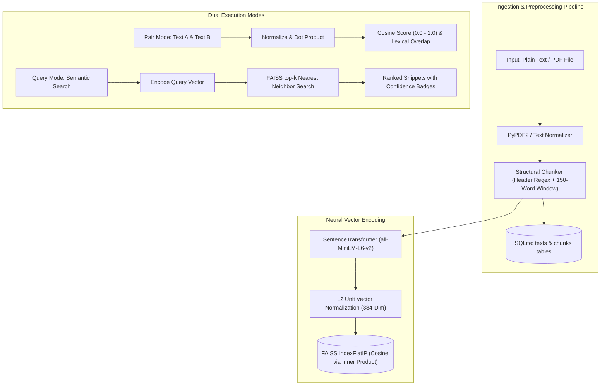

# Semantic Text Similarity & FAISS Retrieval Studio

> **Project #43** · Advanced Neural Text Similarity Analysis & Structural Vector Retrieval System.  
> Built with **Sentence Transformers (`all-MiniLM-L6-v2`)**, **FAISS (`IndexFlatIP`)**, **SQLite**, and **Flask**.

---

## 📌 Architecture Overview



---

## 🚀 Key Features

1. **Dual Similarity Evaluation Modes**:
   - **Pair Comparison Mode**: Computes direct cosine similarity between two texts with instant qualitative tiers (*Extremely High*, *High*, *Moderate*, *Low*, *Unrelated*), interactive animated circular gauges, and shared lexical token extraction.
   - **Corpus Query Search**: Encodes natural language queries and executes sub-millisecond vector similarity search against all structurally indexed document chunks.
2. **Structural Chunker**:
   - Detects markdown headers (`#`, `##`), numbered sections (`Section 1:`, `1.1`), and uppercase titles.
   - Automatically applies a 150-word sliding window with 30-word overlap for oversized sections, preserving semantic coherence without information loss.
3. **Optimized Vector Search with FAISS**:
   - Vectors are L2-normalized upon creation, converting Inner Product (`IndexFlatIP`) directly into exact Cosine Similarity:
     $$\text{Cosine Similarity}(u, v) = \frac{u \cdot v}{\|u\|_2 \|v\|_2} = \hat{u} \cdot \hat{v}$$
   - Strict score clamping guarantees confidence bounds within $[0.0, 1.0]$.
4. **Relational + Vector Storage**:
   - SQLite manages document records, structural chunks, and metadata with cascading deletes.
   - Instant FAISS re-indexing and synchronization via dedicated API endpoints.
5. **Portfolio-Grade Dark UI**:
   - Built with high-contrast slate/charcoal tones, glowing accents, real-time character counters, preset sample pairs, and drag-and-drop PDF ingestion.

---

## 🛠️ Technology Stack

- **Backend**: Python 3.12+, Flask 3.1, Flask-CORS
- **NLP / Embeddings**: `sentence-transformers` (`all-MiniLM-L6-v2`), PyTorch
- **Vector Database**: `faiss-cpu` (384 dimensions, `IndexFlatIP`)
- **Document Parsing**: `PyPDF2`
- **Database**: SQLite3 with foreign key cascading
- **Frontend**: Vanilla HTML5, Modern CSS (Custom Design System, Glassmorphism, Responsive Grid), Vanilla JavaScript ES6+

---

## 📡 REST API Reference

### 1. Pairwise Similarity
- **Endpoint**: `POST /api/similarity/pair`
- **Body**:
  ```json
  {
    "text1": "The quick brown fox jumps over the lazy dog.",
    "text2": "A fast brown fox leaps over a sleepy canine."
  }
  ```
- **Response**:
  ```json
  {
    "score": 0.8513,
    "score_pct": 85.1,
    "label": "Extremely High Similarity",
    "color": "#10b981",
    "description": "The texts express nearly identical or directly synonymous meaning.",
    "text1_words": 9,
    "text2_words": 9,
    "common_words_count": 4,
    "common_words_sample": ["brown", "fox", "over", "the"]
  }
  ```

### 2. Semantic Query Search
- **Endpoint**: `POST /api/similarity/query`
- **Body**:
  ```json
  {
    "query": "scaled dot-product multi-head attention",
    "top_k": 3
  }
  ```
- **Response**:
  ```json
  {
    "query": "scaled dot-product multi-head attention",
    "total_matches": 3,
    "results": [
      {
        "rank": 1,
        "text_id": 1,
        "doc_label": "Neural Networks & Transformer Architecture",
        "chunk_index": 1,
        "score": 0.6760,
        "score_pct": 67.6,
        "label": "Moderate Semantic Overlap",
        "color": "#f59e0b",
        "snippet": "# Transformer Architecture & Attention\nThe Transformer architecture replaces recurrent neural networks with multi-head self-attention..."
      }
    ]
  }
  ```

### 3. Ingest Document
- **Endpoint**: `POST /api/texts`
- **Accepts**:
  - JSON: `{"label": "Title", "content": "Full text..."}`
  - Form Data: `file` (PDF/TXT) and optional `label`
- **Response (HTTP 201)**: Returns document ID, chunk count, and sample chunk previews.

### 4. Corpus Management
- `GET /api/texts`: List all stored documents with metadata.
- `GET /api/texts/<id>`: Get specific document with all structural chunks.
- `DELETE /api/texts/<id>`: Delete document and automatically resynchronize FAISS index.
- `POST /api/rebuild`: Force rebuild FAISS index from SQLite database chunks.
- `GET /api/stats`: System health, total documents, indexed chunks, and embedding dimension.

---

## 💻 Local Setup & Quickstart

### 1. Clone & Navigate
```bash
git clone https://github.com/your-username/semantic-similarity-studio.git
cd semantic-similarity-studio
```

### 2. Activate Virtual Environment & Install Dependencies
```bash
# Windows
python -m venv venv
.\venv\Scripts\activate

# Install requirements
pip install -r requirements.txt
```

### 3. Run Automated Test Suite
```bash
python test_api.py
python test_e2e.py
```

### 4. Start the Application
```bash
python app.py
```
Open your browser and navigate to: **`http://localhost:5000`**

---

## 🧪 Testing Benchmarks

| Test Category | Text A | Text B | Expected Cosine Range | Observed Score |
| :--- | :--- | :--- | :---: | :---: |
| **Identical** | AI is transforming medicine. | AI is transforming medicine. | $1.00$ | **`1.0000`** |
| **Paraphrase** | Quick brown fox jumps over dog. | Fast brown fox leaps over canine. | $> 0.80$ | **`0.8513`** |
| **Moderate Overlap** | Central bank increased interest rates. | Stock market dropped on loan costs. | $0.35 - 0.65$ | **`0.3712`** |
| **Unrelated** | Photosynthesis converts solar energy. | Recipe for beef stroganoff. | $< 0.25$ | **`0.1035`** |

---

## 📂 Project Structure

```
c:/NLP_Project/
├── app.py                 # Flask application & REST API routes
├── engine.py              # SentenceTransformer embeddings & FAISS IndexFlatIP
├── chunker.py             # Structural regex header detection & sliding window
├── database.py            # SQLite database schema, CRUD, and connection pooling
├── requirements.txt       # Clean, streamlined dependencies
├── test_api.py            # Unit & integration test suite
├── test_e2e.py            # End-to-end integration & validation benchmark
├── templates/
│   └── index.html         # Modern dark-mode single-page application
├── static/
│   ├── style.css          # Design system, glassmorphism, responsive grid, gauges
│   └── scripts.js         # Interactive logic, live counters, async API calls
└── data/                  # SQLite database (similarity.db) & FAISS vector index
```
